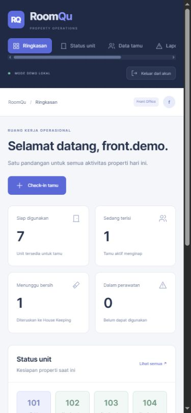
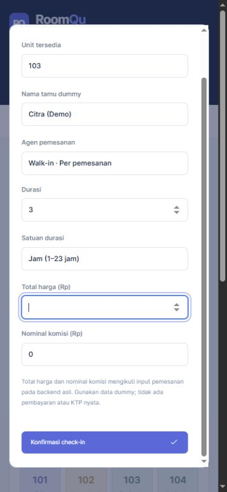
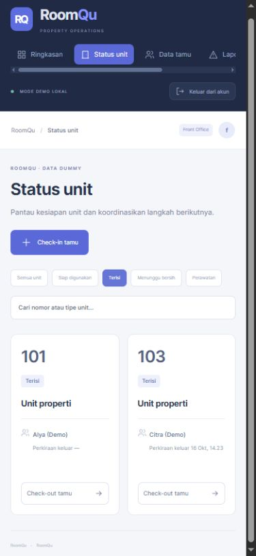

# RoomQu

**A mobile-oriented application for property operations and team handoffs.**

[Bahasa Indonesia](README.md) · [Integration source](https://github.com/KairunHanjun/RoomQu) · [Apache 2.0](LICENSE)

RoomQu connects **Host, Front Office, House Keeping, and Technician** workflows: managing units, welcoming guests, documenting cleaning, and resolving issues. It explores how one application can coordinate unit status and role-specific responsibilities.

The interface remains mobile-oriented, with a maximum 480 px frame on desktop. **Tauri packaging is planned, not implemented.**

## Application preview

<p>
  
  
  
</p>

These screenshots show the running application with dummy data. See the [mobile gallery](docs/screenshots/README.md).

## Features

| Role | Workflow |
| --- | --- |
| Host | Operational overview, staff/unit/agent management, cleaning approval. |
| Front Office | Daily/hourly check-in, check-out, and unit status. |
| House Keeping | Attendance and cleaning documentation. |
| Technician | Attendance, issue reporting, and maintenance resolution. |

Authentication uses Argon2 and the original session flow. Local evidence uploads, property-scoped access, and Excel export support the workflows. Booking prices and commissions are explicit amounts, following the original data model.

## Stack

TypeScript, Svelte 5, SvelteKit 2, Tailwind CSS, Drizzle ORM, the original PostgreSQL schema, PGlite, Argon2, and ExcelJS. The demo uses a **file-backed PGlite database** without an external PostgreSQL server or Cloudinary account.

## Run the demo

Requires **Node.js 24+** and **pnpm**. The integrated implementation is available on `main`:

```sh
git clone https://github.com/KairunHanjun/RoomQu.git
cd RoomQu
pnpm install --frozen-lockfile
pnpm dev:demo
```

On Windows:

```powershell
.\start-demo.ps1
.\start-demo.ps1 -Port 1232
```

Open **http://127.0.0.1:1231**; stop with `Ctrl+C`. Use the default integration mode rather than `ROOMQU_MODE=demo` to exercise the original backend.

| Role | Username | Demo password |
| --- | --- | --- |
| Host | `host.demo` | `DemoRoom123!` |
| Front Office | `front.demo` | `DemoRoom123!` |
| House Keeping | `clean.demo` | `DemoRoom123!` |
| Technician | `tech.demo` | `DemoRoom123!` |

Accounts, guests, sample images, and amounts are fictional. No real identity documents or payments are processed.

## Integration

```text
Mobile UI: / and /User/H, /User/FO, /User/HK, /User/T
  -> ?/integrated form adapter
  -> original handlers: src/lib/server/original
  -> original Drizzle schema: src/lib/server/db/schema.ts
  -> file-backed PGlite demo database
```

The adapter validates role, property, and input before delegating to original handlers. Unsupported schema fields, such as agent percentage commissions or fixed unit rates, are not invented. Hourly bookings follow the original **1–23 hour** contract.

The initial mobile UI from commit `520b0eb` is preserved in [backups](backups/README.md). The refreshed frontend and integration adapters are owner-approved Codex-assisted refinements, not the unchanged original UI.

## Storage and reset

| Data | Default location | Override |
| --- | --- | --- |
| Database | `.demo/original-postgres` | `ROOMQU_PG_DIR` |
| Images | `.demo/original-media` | `ROOMQU_MEDIA_DIR` |

Data persists across restarts. Run one server per database directory. PNG/JPEG/WebP uploads are limited to 2 MB and access is scoped to the relevant property.

**Stop the server before resetting**:

```sh
pnpm demo:reset
pnpm dev:demo
```

Reset restores demo accounts, sessions, and operational records while retaining uploaded images.

## Checks and build

```sh
pnpm test:integrated
pnpm check
pnpm build
```

Local verification on 16 October 2026 recorded **52 passing HTTP integration checks**, clean Svelte checks, and a successful build. Tests use a separate server on port 1251 and an isolated database. See the [integration report](docs/integration-verification.md).

## Current limitations

- External PostgreSQL/Cloudinary, production deployment, and Tauri packaging are unverified.
- Cleaning approval deletes its documentation; severe maintenance resolution returns a unit to Ready, matching original handler behavior.
- The refreshed frontend does not reproduce every original UI feature.
- `ROOMQU_MODE=demo` and `pnpm test:prototype` refer to the independent SQLite prototype, not original-backend verification.
- `ROOMQU_MODE=live` selects external integrations requiring separate configuration. PWA caching is enabled only for an explicitly selected live build.

Originally developed independently by **Guntur Ahmad Lion Putranto**. Codex assisted with subsequent frontend, integration, and portfolio documentation work.

## License

Project code is licensed under the **Apache License 2.0**; see [LICENSE](LICENSE). Third-party dependencies and assets retain their respective licenses.
